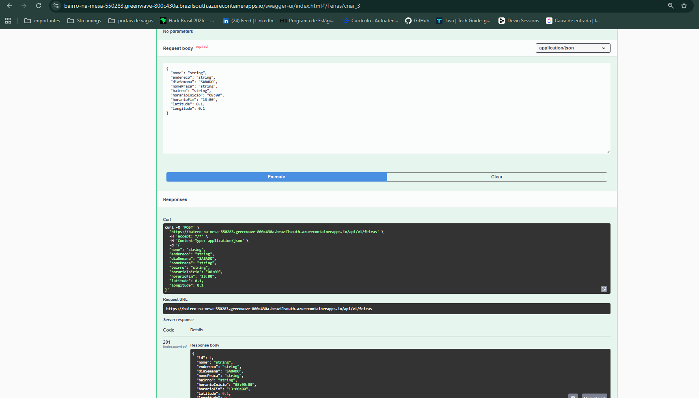
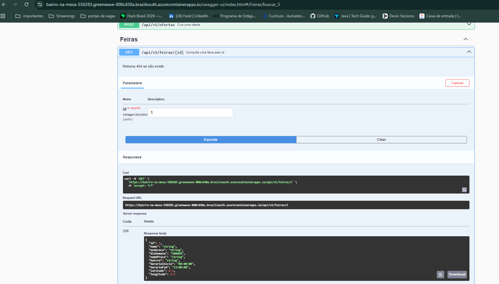

# Bairro na Mesa API

API REST da Global Solution 2026.2 (turma 3SIR, Microservice and Web Engineering & IT Services).

## Objetivo

O **Bairro na Mesa** transforma praças da periferia em pontos semanais de comida acessível: feiras de agricultores familiares e hortas comunitárias, com pré-pedido pelo celular e retirada por código.

Esta API cobre o módulo principal, a **Feira na Praça**:

1. O organizador cadastra a **feira** (praça, dia e horário).
2. O **produtor** se cadastra e publica a **oferta** da semana (produto, preço e estoque).
3. O morador faz o **pedido** (pré-pedido). A API baixa o estoque, calcula o total e gera o código de retirada.

## Links da entrega

| Item | Link |
|---|---|
| API no Azure | <https://bairro-na-mesa-550283.greenwave-800c430a.brazilsouth.azurecontainerapps.io> |
| Docker Hub | `https://hub.docker.com/r/joave/bairro-na-mesa-api` |
| Workflow | `.github/workflows/docker-publish.yml` (aba **Actions** do repositório) |

## Integrantes

| Nome | RM |
|---|---|
| `João Victor Oliveira Avellar` | `550283` |

## Tecnologias

Java 21, Spring Boot 3.5 (Web, Data JPA, Validation), Microsoft SQL Server, ModelMapper, springdoc-openapi (Swagger), Docker e GitHub Actions.

## Arquitetura

```
controller  ->  service  ->  repository  ->  SQL Server
   (DTOs)     (regras)        (JPA)
```

| Pacote | Papel |
|---|---|
| `controller` | Rotas REST `/api/v1/...`. Só conversa com o Service. |
| `service` | Regras de negócio e conversão entre Entity e DTO (ModelMapper). |
| `repository` | Acesso ao SQL Server (Spring Data JPA). |
| `entity` | Tabelas `feiras`, `produtores`, `ofertas` e `pedidos`. |
| `dto.request` / `dto.response` | Entrada e saída da API. As entidades nunca são expostas. |
| `exception` | Erros padronizados (ProblemDetail), sem stack trace na resposta. |

### Entidades

```
Feira 1──N Oferta N──1 Produtor
             │
             1──N Pedido
```

### Regras de negócio do pedido

- Pedido acima do estoque da oferta é recusado com `400`.
- Criar um pedido baixa o estoque. Cancelar ou excluir um pedido pendente devolve o estoque.
- `valorTotal`, `codigoRetirada`, `dataPedido` e o status inicial (`PENDENTE`) são definidos pela API.

## Endpoints

Cada recurso tem o CRUD completo: `feiras`, `produtores`, `ofertas` e `pedidos`.

| Método | Rota | Sucesso | Erros |
|---|---|---|---|
| POST | `/api/v1/{recurso}` | 201 | 400, 404 (vínculo inexistente) |
| GET | `/api/v1/{recurso}` | 200 | |
| GET | `/api/v1/{recurso}/{id}` | 200 | 404 |
| PUT | `/api/v1/{recurso}/{id}` | 200 | 400, 404 |
| DELETE | `/api/v1/{recurso}/{id}` | 204 | 404, 409 (registro em uso) |

A documentação interativa (Swagger) abre na rota raiz `/`.

## Como executar localmente

### Opção rápida: Docker Compose (um comando)

Pré-requisito: Docker. Sobe o SQL Server, cria o banco e inicia a API.

```bash
cp .env.example .env
```

Edite o `.env` e troque a senha em `DB_PASSWORD` (mínimo de 8 caracteres, com maiúscula, minúscula, número e símbolo). Depois:

```bash
docker compose up --build
```

Acesse <http://localhost:8080/>. Os dados ficam no volume `sqldata` e sobrevivem a `docker compose down`. Para apagar tudo, inclusive o banco:

```bash
docker compose down -v
```

### Opção manual: Spring Boot com SQL Server em container

Pré-requisitos: Java 21, Maven e Docker.

#### 1. Subir o SQL Server

Escolha uma senha forte (mínimo de 8 caracteres, com maiúscula, minúscula, número e símbolo) e use a mesma nos passos seguintes.

```bash
docker run -d --name sqlserver -e ACCEPT_EULA=Y -e MSSQL_SA_PASSWORD=<SuaSenhaForte> -p 1433:1433 mcr.microsoft.com/mssql/server:2022-latest
```

Crie o banco (as tabelas são criadas pela aplicação na primeira execução):

```bash
docker exec sqlserver /opt/mssql-tools18/bin/sqlcmd -S localhost -U sa -P <SuaSenhaForte> -C -Q "CREATE DATABASE bairronamesa"
```

#### 2. Configurar as variáveis de ambiente

A aplicação lê a conexão de variáveis de ambiente. Nenhuma credencial fica no repositório.

| Variável | Obrigatória | Padrão |
|---|---|---|
| `DB_PASSWORD` | sim | |
| `DB_USERNAME` | não | `sa` |
| `DB_URL` | não | `jdbc:sqlserver://localhost:1433;databaseName=bairronamesa;encrypt=true;trustServerCertificate=true` |
| `PORT` | não | `8080` |

#### 3. Executar o Spring Boot

PowerShell:

```powershell
$env:DB_PASSWORD = "Microsservices@2026"; mvn spring-boot:run
```

Linux/macOS:

```bash
DB_PASSWORD='Microsservices@2026' mvn spring-boot:run
```

Acesse <http://localhost:8080/>.

#### Testes automatizados

```bash
mvn test
```

Os testes usam um banco H2 em memória e não precisam do SQL Server.

## Docker Hub

Imagem: `joave/bairro-na-mesa-api`, tag `latest` (cada commit também gera uma tag com o hash).

```bash
docker pull joave/bairro-na-mesa-api:latest
```

```bash
docker run -p 8080:8080 -e DB_URL="jdbc:sqlserver://host.docker.internal:1433;databaseName=bairronamesa;encrypt=true;trustServerCertificate=true" -e DB_USERNAME=sa -e DB_PASSWORD=<SuaSenhaForte> joave/bairro-na-mesa-api:latest
```

Para construir a imagem localmente:

```bash
docker build -t bairro-na-mesa-api .
```

## Continuous Delivery (GitHub Actions)

O workflow `.github/workflows/docker-publish.yml` roda a cada push na branch `main`:

1. Compila e testa a aplicação (`mvn verify`).
2. Constrói a imagem Docker.
3. Faz login e publica a imagem no Docker Hub.

Ele precisa de dois *secrets* no repositório (Settings → Secrets and variables → Actions):

| Secret | Valor |
|---|---|
| `DOCKERHUB_USERNAME` | usuário do Docker Hub |
| `DOCKERHUB_TOKEN` | token de acesso criado em Docker Hub → Account settings → Personal access tokens |

## Implantação no Azure

A API roda no **Azure Container Apps** e o banco no **Azure SQL Database**. Passos com a Azure CLI (troque os valores entre `< >`):

```bash
az group create -n rg-bairro-na-mesa -l brazilsouth
```

```bash
az sql server create -g rg-bairro-na-mesa -n <nome-servidor-sql> -l brazilsouth -u <admin> -p <SenhaForte>
```

```bash
az sql db create -g rg-bairro-na-mesa -s <nome-servidor-sql> -n bairronamesa --service-objective Basic
```

Liberar o acesso de serviços do Azure ao banco:

```bash
az sql server firewall-rule create -g rg-bairro-na-mesa -s <nome-servidor-sql> -n AllowAzure --start-ip-address 0.0.0.0 --end-ip-address 0.0.0.0
```

```bash
az containerapp env create -g rg-bairro-na-mesa -n bnm-env -l brazilsouth
```

```bash
az containerapp create -g rg-bairro-na-mesa -n bairro-na-mesa-api --environment bnm-env --image docker.io/joave/bairro-na-mesa-api:latest --target-port 8080 --ingress external --secrets db-password=<SenhaForte> --env-vars "DB_URL=jdbc:sqlserver://<nome-servidor-sql>.database.windows.net:1433;databaseName=bairronamesa;encrypt=true" DB_USERNAME=<admin> DB_PASSWORD=secretref:db-password
```

O último comando mostra a URL pública da API. Para atualizar depois de uma nova imagem:

```bash
az containerapp update -g rg-bairro-na-mesa -n bairro-na-mesa-api --image docker.io/joave/bairro-na-mesa-api:latest
```

## Como testar

O jeito mais simples é o Swagger na rota `/`. Pelo terminal, siga a ordem abaixo (troque `http://localhost:8080` pela URL do Azure).

> Os exemplos usam Git Bash ou Linux/macOS e não têm acentos de propósito: no Windows, o `curl` corrompe acentos passados na linha de comando e a API responde `400`. Para enviar texto acentuado, use o Swagger ou um arquivo (`--data-binary @corpo.json`).

```bash
curl -i -X POST http://localhost:8080/api/v1/feiras -H "Content-Type: application/json" -d '{"nome":"Feira Central","endereco":"Rua A, 10","diaSemana":"SABADO","horarioInicio":"08:00","horarioFim":"13:00"}'
```

```bash
curl -i -X POST http://localhost:8080/api/v1/produtores -H "Content-Type: application/json" -d '{"nome":"Sr. Pedro","tipo":"AGRICULTOR_FAMILIAR","municipio":"Mogi das Cruzes"}'
```

```bash
curl -i -X POST http://localhost:8080/api/v1/ofertas -H "Content-Type: application/json" -d '{"produtoNome":"Alface","precoUnitario":4.50,"quantidadeDisponivel":10,"unidade":"un","idFeira":1,"idProdutor":1}'
```

```bash
curl -i -X POST http://localhost:8080/api/v1/pedidos -H "Content-Type: application/json" -d '{"nomeMorador":"Dona Maria","quantidade":3,"idOferta":1}'
```

Resultados esperados:

| Teste | Resposta |
|---|---|
| Os quatro POST acima | `201 Created` |
| `GET /api/v1/ofertas/1` depois do pedido | `200`, com `quantidadeDisponivel` igual a 7 |
| POST de pedido com `quantidade` 99 | `400 Bad Request` |
| POST de feira com corpo `{}` | `400`, com a lista de campos em `erros` |
| `GET /api/v1/feiras/999` | `404 Not Found` |
| `DELETE /api/v1/feiras/1` (feira com oferta) | `409 Conflict` |
| `DELETE /api/v1/pedidos/1` | `204 No Content` |

Para comprovar a persistência, reinicie a aplicação e repita um `GET`: os dados continuam no SQL Server.

## Evidências no Azure

Testes feitos pelo Swagger na URL pública, com a API rodando no Azure Container Apps e gravando no Azure SQL.

**1. Criação de uma feira (`POST /api/v1/feiras` → `201 Created`)**



**2. Consulta do registro gravado (`GET /api/v1/feiras/1` → `200 OK`)**

A consulta devolve a feira criada no passo anterior, o que comprova a persistência no SQL Server.


